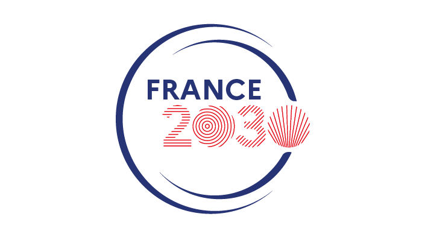
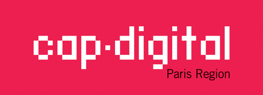

<p align="center">
  <picture>
    <source media="(prefers-color-scheme: dark)" srcset="doc/assets/logo/hamac-logo-horizontal-sombre.svg">
    
  </picture>
</p>

# Hamac

*Zero-touch infrastructure orchestration: turn declarative service manifests into resolved, deployed infrastructure — with security zones inferred from your data, not bolted on.*

> **Canonical repository:** https://forge.ocamlpro.com/OSS/hamac — the GitHub repository is a read-only mirror. Please file issues and merge requests on Forgejo.

**Hamac** is an infrastructure orchestrator. It reads
declarative manifests, written in [LOAF](https://forge.ocamlpro.com/OSS/loaf),
describing services and infrastructure,
resolves their dependencies to concrete providers, and provisions/deploys them —
including **bare-metal provisioning over PXE**.

Developed by [OCamlPro](https://www.ocamlpro.com) and released under the
**GNU Affero General Public License v3.0** (see [`LICENSE`](LICENSE)).

## Components

| Package | Path | Role |
|---|---|---|
| `hamac` | `pkgs/hamac` | CLI: `validate` / `plan` / `resolve` / `simulate` / `deploy`, and `provision-*` (render + push cloud-init/iPXE to the discovery server). |
| `hamac-manifest` | `pkgs/hamac-manifest` | Library: the pivot manifest format — types, LOAF loader and vocabulary of Hamac with its security models (Bell-LaPadula, RBAC), coded diagnostics, flows and filtering. Usable on its own by any tool that reads or writes manifests. |
| `hamac-clingo` | `pkgs/hamac-clingo` | Library: OCaml binding of libclingo (C API of the clingo ASP solver), independent of Hamac. The planner places replicas with it. |
| `hamac-provisioning` | `pkgs/hamac-provisioning` | Library: provisioning-profile rendering (cloud-init + iPXE). |
| `hamac-discovery` | `pkgs/hamac-discovery` | Discovery server: stores a provisioning record per MAC and serves the aggregated cloud-init to PXE-booting machines. |

## Build

Requires OCaml, opam and dune. **All OCaml dependencies are public opam
packages.** The planner also needs **libclingo**, the C library of the
[clingo](https://potassco.org/clingo/) ASP solver (5.x): Fedora packages it
(`clingo-devel`), Homebrew too (`clingo`). Debian and Ubuntu do not (their
`gringo` package only ships the executables): build it from its official
sources, as the CI does, and give its prefix to the build:

```sh
curl -fsSL https://github.com/potassco/clingo/archive/refs/tags/v5.8.2.tar.gz | tar -xz
cmake -S clingo-5.8.2 -B clingo-build -DCMAKE_BUILD_TYPE=Release \
  -DCMAKE_INSTALL_PREFIX="$HOME/.local/clingo" \
  -DCLINGO_BUILD_WITH_PYTHON=OFF -DCLINGO_BUILD_WITH_LUA=OFF
cmake --build clingo-build -j && cmake --install clingo-build
export CLINGO_PREFIX="$HOME/.local/clingo"   # not needed for /usr or /usr/local
```

then:

```sh
opam install --deps-only .
dune build
```

Build files (`dune`, `dune-project`, `opam/*.opam`) are generated from
`recipe.yaml` by [marmiton](https://ocaml.org). Edit the recipe, then run
`marmiton build` to regenerate them (maintainer flow only — the generated files
are committed, so building does not require marmiton).

## Usage

The commands below run as-is from the root of this repository, against the
example manifests it ships.

```sh
# Validate / plan / resolve manifests. The files given (a directory stands
# for the .loaf files it contains) form one set: it includes the providers
# that the services consume.
hamac validate examples/enterprise-stack providers
hamac plan     examples/enterprise-stack providers
hamac resolve  examples/enterprise-stack providers

# A stack loads its pattern, a LOAF module, from a library directory:
# ./patterns by default, or -L DIR.
hamac plan examples/hr-stack providers

# Credentials come from the system CSPRNG. --seed makes them reproducible for
# tests and demos, and therefore predictable: never use it for a real deployment.
hamac resolve --seed 42 examples/enterprise-stack providers

# Bare-metal provisioning
hamac provision-dryrun --profile=provisioning-profiles/dev-workstation-demo.loaf
hamac provision-push   --profile=provisioning-profiles/dev-workstation.loaf \
                       --mac=aa:bb:cc:dd:ee:ff \
                       --discovery=http://discovery:8877
hamac provision-clear  --mac=aa:bb:cc:dd:ee:ff --discovery=http://discovery:8877
```

Run `hamac --help` for the full command list.

### Files Hamac looks for

| Directory | Contents | Looked up |
|---|---|---|
| `providers/` | Provider manifests (`postgresql`, `redis`) — a provider is a `service` block that fills the contract of its capability (`database postgresql { … }`), not a compiled plugin. | passed on the command line, with the services that consume them |
| `patterns/` | Patterns: LOAF modules (`module exemple_rh 1.0.0.`) that a stack loads by `use`. | `-L DIR`, then `./patterns`, then `~/.hamac/patterns` |
| `templates/bundles/<name>/` | Provisioning bundles: `bundle.loaf` + cloud-init Jinja2 templates. | `./templates/bundles`, `/usr/share/hamac/bundles`, or `--bundles-dir` |
| `provisioning-profiles/` | `provisioning_profile` manifests. `dev-workstation.loaf` takes its parameters from the machine record; `dev-workstation-demo.loaf` carries them inline so a dry run needs nothing else. | passed with `--profile` |
| `examples/enterprise-stack/` | Three services across three security zones, consuming a database and a cache; `analytics` (internal) reads `web_api` (public). | passed on the command line |
| `examples/hr-stack/` | A stack with its pattern (`patterns/exemple_rh.loaf`, a module found among the files given): security models, zones, routes, storage, placement requirements (`hamac_ha`). | passed on the command line |

## Security zones and flows

Each service declares a security zone. The patterns define the zones and
choose the security model that orders them: Hamac ships a Bell-LaPadula model
(`hamac_blp`), a role model (`hamac_rbac`) and a ready-made pattern
(`hamac_default`: `public` < `default` < `internal` < `secure`); an
organisation can write its own. Hamac derives the network filtering from the
order:

- **No read up.** Opening a connection to a service means reading from it, so
  a zone can only open connections to the zones the model lets it read.
  Validation rejects any service that declares another dependency.
- **Read down, only when declared.** A service may consume a service of a less
  sensitive zone (`consumes api { service web_api. }`); Hamac then opens exactly that
  flow, to that service's port, and nothing else between the two zones.
- **Stateful.** Replies to an allowed connection pass; every other connection
  between zones is denied.

```loaf
% analytics (zone internal) reads the public API: allowed, and opened
consumes api {
  service web_api.
  inject "API_URL", fmt("http://{~.host}:{~.port}").
}
```

Writing down — a sensitive service sending data to a less sensitive zone,
including inside the request of an allowed connection — is not a network
matter: it belongs to application-level controls or to a filtering data diode.

`hamac simulate` enforces these rules: each node is attached only to its own
zone's network and to those it may read from, with a fixed address, and
`iptables` filters new connections both at node level and in `DOCKER-USER` for
the service containers. `hamac deploy` produces a flat docker-compose on a
single network and does not isolate zones (it warns about it).

## Bare-metal provisioning (PXE)

`hamac-discovery` runs alongside a PXE stack (`docker/hamac-pxe`, dnsmasq proxy
DHCP + TFTP + iPXE). A machine boots over PXE, fetches its cloud-init from the
discovery server (keyed by MAC), and the OS image is written to disk. See
[`doc/typst/provisioning.typ`](doc/typst/provisioning.typ) for the full contract
(image formats, `bmaptool` write path, first-boot resize).

## Documentation

The reference documents are written in [Typst](https://typst.app) and built as
PDF (`make -C doc`, typst ≥ 0.15). CI builds them on every push and, on
`master`, publishes them to the forge's package registry
(<https://forge.ocamlpro.com/OSS/-/packages/generic/hamac-docs/latest>); the
links below always give the latest version, and each tagged milestone carries
the PDF of its version in its release.

- Manifest format specification (0.2, draft): [PDF](https://forge.ocamlpro.com/api/packages/OSS/generic/hamac-docs/latest/manifest.pdf), source [`doc/typst/manifest.typ`](doc/typst/manifest.typ).
- The modules shipped with Hamac — security models (`hamac_blp`, `hamac_rbac`), placement (`hamac_ha`), default pattern (`hamac_default`): [PDF](https://forge.ocamlpro.com/api/packages/OSS/generic/hamac-docs/latest/modules.pdf), source [`doc/typst/modules.typ`](doc/typst/modules.typ).
- Provisioning profiles and disk write: [PDF](https://forge.ocamlpro.com/api/packages/OSS/generic/hamac-docs/latest/provisioning.pdf), source [`doc/typst/provisioning.typ`](doc/typst/provisioning.typ).
- Round-based control plane (design proposal): [PDF](https://forge.ocamlpro.com/api/packages/OSS/generic/hamac-docs/latest/control-plane.pdf), source [`doc/typst/control-plane.typ`](doc/typst/control-plane.typ).
- [`pkgs/hamac-manifest/vocabulary/hamac.loaf`](pkgs/hamac-manifest/vocabulary/hamac.loaf) — the vocabulary of Hamac: the blocks of the manifests, their defaults and validations, in LOAF. The language itself is specified in [LOAF](https://forge.ocamlpro.com/OSS/loaf) ([PDF](https://forge.ocamlpro.com/api/packages/OSS/generic/loaf-spec/latest/loaf.pdf)).
- [`doc/HAMAC_ROADMAP.md`](doc/HAMAC_ROADMAP.md) — milestones.

## Funding

<p>
  
  &nbsp;&nbsp;
  
  &nbsp;&nbsp;
  
  &nbsp;&nbsp;
  
</p>

> « Ce projet a été financé par le Gouvernement dans le cadre du plan France 2030
> opéré par Cap Digital et financé par l'Union européenne – NextGeneration EU »
>
> « Ce projet a été financé par le gouvernement dans le cadre de France 2030 »
>
> « Financé par l'Union européenne - Next Generation EU dans le cadre du plan
> France Relance »

*This project was funded by the French Government under the France 2030 plan
operated by Cap Digital, and by the European Union – NextGenerationEU under the
France Relance plan.*

## Licensing

Hamac is **dual-licensed** by OCamlPro:

- **Open source** — [GNU AGPL-3.0](LICENSE). Free to use, modify and
  redistribute under the AGPL's terms, **including its network-copyleft**: if
  you run a modified version as a network service, you must offer its users the
  complete corresponding source.
- **Commercial** — for organizations that cannot or do not wish to comply with
  the AGPL (e.g. embedding Hamac in a proprietary product or a closed-source
  SaaS), a commercial license is available from OCamlPro.

See [`LICENSING.md`](LICENSING.md) for details. Contributions require a signed
CLA so they can be offered under both licenses — see [`CONTRIBUTING.md`](CONTRIBUTING.md).

Commercial licensing & questions: **contact@ocamlpro.com**.
